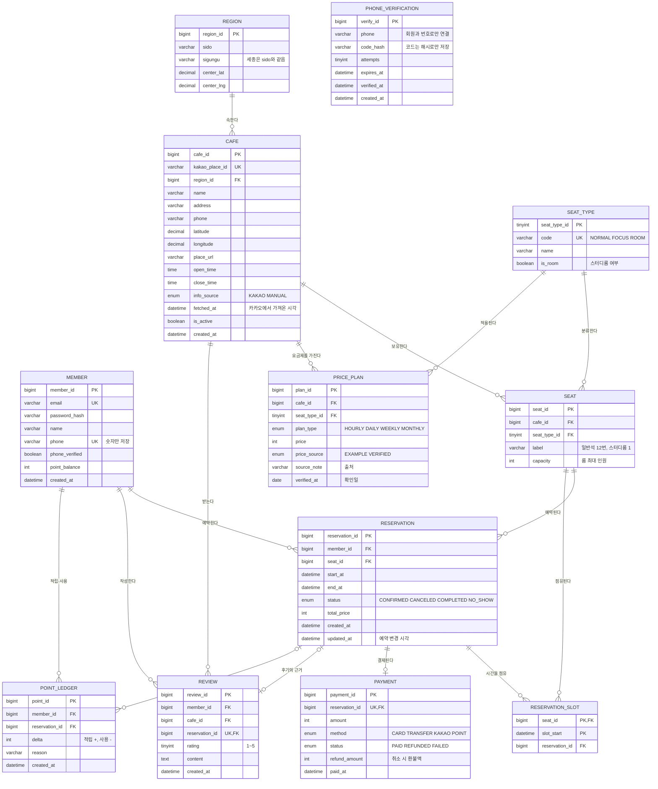

# 스터디모아 ERD (v5)

작성일 2026-11-02, 개정 2026-11-05 · 대상: 현재 사이트(`public/app.js`)와 서버(`server/index.js`) 기능 전체 · DBMS: MySQL 8 (InnoDB)

테이블 12개 · 뷰 없음. 실제 DB(`db/schema.sql`)와 같은 구조(컬럼 84개를 스키마·운영 DB와 전수 대조)이며, 제약 규칙(이중 예약 차단, 중복 가입 차단, 요금 출처 규칙)은 DB에서 직접 검증했다.

## ER 다이어그램

## 업무 영역 ↔ 테이블 (업무 영역 분할도와 연결)

| 업무 영역 | 사이트 기능 | 주 테이블 |
|---|---|---|
| 이용 옵션 선택 | 시간제/기간제, 좌석 유형, 인원 | SEAT_TYPE, SEAT, PRICE_PLAN |
| 지역 설정 | 시·도·구 선택, 현재 위치, 역·대학 근처(카카오 검색으로 화면에서 계산, DB에 저장하지 않음) | REGION, CAFE |
| 비교 및 추천 | 구 평균 대비 요금, 후기 | PRICE_PLAN, REVIEW, CAFE, REGION |
| 고객 예약 | 좌석 선택, 결제, 변경·취소·환불, 내 예약, 포인트 | MEMBER, RESERVATION, RESERVATION_SLOT, PAYMENT, POINT_LEDGER |
| 회원 관리 | 가입(휴대폰 인증·중복 차단), 로그인 | MEMBER, PHONE_VERIFICATION |

## 핵심 설계 결정

1. **이중 예약 차단은 DB가 한다.** `RESERVATION_SLOT`의 기본키 `(seat_id, slot_start)`가 같은 좌석·같은 1시간 칸의 중복 삽입을 막는다. 예약·슬롯·결제·포인트는 한 트랜잭션으로 묶는다. 취소하면 슬롯을 지워 자리를 돌려준다. 기간제(1일·7일·30일)도 시간 칸 24·168·720개로 같은 방식으로 점유한다.
2. **실제 요금과 예시 요금을 섞지 않는다.** `PRICE_PLAN.price_source`가 `EXAMPLE`이면 화면에 "예시"로 표시하고, 팀이 조사해 넣은 값만 `VERIFIED`(+출처 `source_note`, 확인일 `verified_at`)로 올린다. `VERIFIED`인데 출처·확인일이 없으면 CHECK 규칙이 막는다. 서버의 평균 비교 SQL은 `VERIFIED`만으로 계산한다. 화면은 조회한 카페들의 예시 요금으로 평균과 차액을 계산한다.
3. **카카오에서 가져온 정보에는 출처 시각을 남긴다.** `CAFE.info_source`, `fetched_at`, `kakao_place_id`(중복 방지 UK), `place_url`. 카카오는 요금·좌석 정보를 주지 않으므로 이 값들은 별도로 관리한다.
4. **좌석을 낱개로 둔다.** 사이트가 "일반석 12번"처럼 번호별로 고르게 하므로 `SEAT` 한 행이 좌석 하나다. 유형은 `SEAT_TYPE`(일반석·집중석·스터디룸)으로 분리해 `PRICE_PLAN`과 같은 기준으로 연결한다.
5. **범위를 단순화한다.** 카페 찜과 시설별 관리·검색을 제외해 N:M 연결 테이블은 없다. 평균 대비 표시·정렬은 유지하며 뷰 대신 일반 SQL과 화면 계산을 사용한다.
6. **포인트는 잔액 + 원장.** `MEMBER.point_balance`는 조회용 값이고, 변동 이력은 `POINT_LEDGER`에 쌓는다. 포인트 결제는 `PAYMENT.method = POINT`와 원장 `-` 행이 한 쌍이다. 잔액은 0 미만이 될 수 없다(CHECK).
7. **중복 가입을 DB에서 막는다.** 이메일(`uq_member_email`)과 휴대폰 번호(`uq_member_phone`)가 각각 유일하다. 서버는 이메일을 소문자로 정리하고 번호는 숫자만 저장해 표기 차이로 우회하지 못하게 한다.
8. **휴대폰 인증은 코드를 해시로만 저장한다.** `PHONE_VERIFICATION`은 만료(5분)와 시도 횟수(5회)를 제한하고, 인증을 마친 번호만 15분 안에 가입할 수 있으며, 가입이 끝나면 인증 기록을 지워 재사용을 막는다. 실제 문자 발송 업체는 연결하지 않아 모의 모드로 동작한다.
9. **환불은 결제에 기록한다.** 시간제는 이용 1시간 전까지 100%, 이후 50%, 기간제는 시작 전 100%이며 결제 행의 `refund_amount`에 남긴다. 포인트로 결제했다면 같은 금액을 포인트로 돌려준다.
10. **카카오 카페는 처음 쓸 때 또는 가져오기로 저장한다.** 사이트는 지역을 고르면 카카오에서 불러오고, 예약 시점에 서버가 그 카페를 등록한다. 전국 6,142곳은 `npm run db:import`로 한 번에 넣었다.

## v1 대비 변경

| 구분 | 내용 |
|---|---|
| 추가 | `SEAT_TYPE`, `POINT_LEDGER`, `PHONE_VERIFICATION` |
| 이름 변경 | `room` → `seat` (낱개 좌석과 룸을 모두 담으므로) |
| 컬럼 추가 | `cafe.place_url·info_source·fetched_at·is_active`, `region.center_lat·center_lng`, `price_plan.price_source·source_note·verified_at`, `member.point_balance·phone_verified`, `reservation.updated_at`, `payment.refund_amount`, `payment.method`에 `KAKAO` |
| 규칙 변경 | `member.phone`을 유일(UNIQUE)로 |
| 유지 | `member`, `region`, `cafe`, `price_plan`, `reservation`, `reservation_slot`, `payment`, `review` |
| 삭제 | 예약 상태 `PENDING` (사이트는 예약 즉시 `CONFIRMED`이므로 쓰지 않음) |

## v3 → v4 변경 (2026-11-05, 범위 정리)

| 제거 | 이유 |
|---|---|
| 사장·관리자 구분 (`member.role`, `cafe.owner_id`, `info_source`의 OWNER) | 사장·관리자 기능이 없고 서버·화면이 쓰지 않음 |
| 소셜 로그인 (`MEMBER_SOCIAL`) | 외부 설정이 없어 한 번도 쓰지 못했고 범위에서 제외 |
| 역·대학 (`LANDMARK`, `CAFE_LANDMARK`) | 데이터가 없고 화면의 역세권·대학가 필터는 카카오 검색으로 직접 계산함 |

## 아직 정해지지 않은 것 (팀 결정 필요)
- **PASS 본인인증.** 통신사 본인확인기관 계약이 필요해 범위 밖이다. 휴대폰 인증은 모의 문자 인증으로 대신한다.

## 정해진 것 (이전 초안의 미정 사항)

- **기간제(일·주·월권)와 시간 슬롯**: 기간제도 1시간 슬롯 24·168·720개로 점유하도록 했다. 스터디룸은 시간제로만 예약한다.
- **카카오 카페 저장 범위**: 전국 6,142곳을 DB에 저장했다. 카카오 장소 정보를 통째로 저장하는 것이라 약관상 문제가 될 수 있다는 점은 알고 선택했다.

## v4 → v5 변경

- 찜 및 시설 기능 제거: FAVORITE, CAFE_FACILITY, FACILITY 제거.
- 평균 대비 표시·정렬 유지. 상세 API의 뷰 참조를 일반 SQL로 대체하고 뷰 제거.
- 테이블 12개, 속성 84개, 외래키 15개, 개체 12개, 관계 15개.
